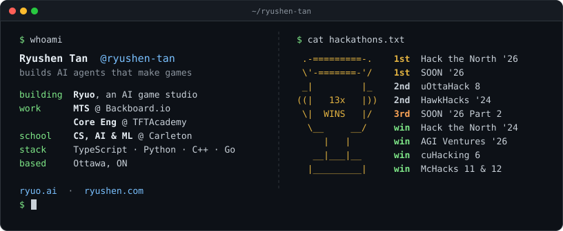

  

  
  &nbsp;
  

  <a href="https://ryuo.ai">ryuo.ai</a> ·
  <a href="https://ryushen.com">ryushen.com</a> ·
  <a href="https://www.linkedin.com/in/ryushen/">linkedin</a> ·
  <a href="https://x.com/RyushenTan">x</a> ·
  <a href="mailto:ryushen@gmail.com">email</a>

